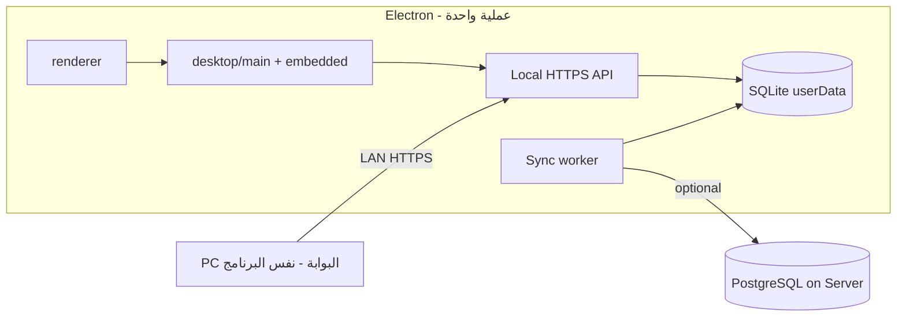

# رؤية التطبيق الموحّد — من v0.2 إلى v1 «تثبيت → تشغيل»

هذا المستند يربط **ما تطلبه** (برنامج واحد، SQLite، تفعيل بسيط، بوابة، مزامنة اختيارية) بـ **ما هو موجود اليوم**، ومسار تنفيذ **تدريجي** بدون كسر البيانات أو التراخيص الحالية.

---

## الوضع الحالي (0.2.x) — باختصار

| طبقة | الواقع اليوم |
|------|----------------|
| **التطبيق** | Electron + واجهة `renderer/` (عسكريون، بوابة POS، كانتين، …) |
| **الخادم** | Node.js منفصل — `server/` — HTTPS + PostgreSQL (أو PGlite في Lab) |
| **العميل ↔ الخادم** | طلبات موقّعة (`X-Device-Id` + مفتاح خاص DPAPI) |
| **الترخيص** | ملف `license.json` موقّع: **جهازان فقط** — `internal` + `gate` (مفتاح عام لكل جهاز، ليس MachineGuid) |
| **«جهاز البوابة»** | **كمبيوتر ثاني** يشغّل نفس البرنامج بدور `gate` ويتصل **بنفس الخادم على LAN** — ليس SDK لبوابة/ترنست physically |
| **المسح** | QR + إدخال الرقم؛ قارئ USB «لوحة مفاتيح» مذكور في `js/screens.js` (`listenScanner`) — **غير مربوط** في `renderer/app.js` الحالي (التركيز على حقل الرقم يكفي لأغلب القراء) |
| **التشغيل** | Lab/demo: `lab:server` + Electron + CA + ترخيص — سبب تعقيد التجربة |

---

## الهدف (ما وصفته)

```
تثبيت → فتح → Machine ID → Activation Code → مصدر بيانات → البوابة → عمل
```

- **SQLite** محلي تلقائي (إنشاء + migrations عند أول تشغيل).
- **خدمة مدمجة** (embedded) — المستخدم **لا** يشغّل `lab:server` يدويًا.
- **تفعيل**: معرّف جهاز مستقر + كود من موقع التراخيص + تحقق وتخزين آمن.
- **بوابة**: اكتشاف/إعداد جهاز البوابة + صلاحيات — **مع الحفاظ على** جهاز البوابة الحالي (PC + API).
- **سيرفر موجود**: مزامنة عبر API آمن — **PostgreSQL على السيرفر يبقى**؛ لا «تحويل السيرفر إلى SQLite».
- **Offline**: عمل محلي على SQLite؛ مزامنة عند توفر الاتصال + سياسة تعارض.

---

## فصل المفاهيم (كما طلبت)

| المفهوم | v0.2 | v1 المقترح |
|---------|------|------------|
| **ترخيص الكمبيوتر** | UUID + زوج مفاتيح في `license.json` | **طبقة جديدة**: Machine ID + Activation Code؛ **محول** يقبل التراخيص القديمة |
| **صلاحية البوابة** | `kind=gate` + user `role=gate` | شاشة «الأجهزة/البوابة»: قائمة أجهزة gate مسموحة + إضافة/إلغاء (امتداد لـ `license.devices` + جدول محلي) |
| **مصدر البيانات** | PostgreSQL مركزي فقط | **SQLite افتراضي** + وضع «متصل بسيرفر الوحدة» للمزامنة |

---

## البوابة والبروتوكول — إجابة قبل «اكتشاف تلقائي»

**في الكود الحالي لا يوجد بروتوكول IP/منفذ لجهاز بوابة hardware.**

- «البوابة» = **عميل Electron** على PC عند المدخل يستدعي `POST /api/gate` على الخادم.
- أي **ترنست/PLC/Arduino** غير مدمج؛ إن وُجد في الميدان، نحتاج: نوع الجهاز، SDK/API، TCP/Serial/Modbus، إلخ.

**ما يمكن تنفيذه فورًا بدون SDK:**

- اكتشاف **أجهزة Gate على الشبكة** = البحث عن **تثبيتات أخرى للبرنامج** أو **ping** لعنوان IP معروف + اختبار `GET /api/summary` الموقّع (بعد تفعيل).
- إعداد يدوي: `https://gate-pc.local:8443` أو IP — **للعميل Gate** وليس لترنست.
- إعادة ربط `listenScanner` في واجهة البوابة لقارئ USB.

**ما يحتاج معلومات منك:** هل «جهاز البوابة» = PC + برنامج فقط، أم يوجد **جهاز تحكم/قارئ** ببروتوCOL محدد؟

---

## هندسة v1 مقترحة (برنامج واحد)



- **Embedded service**: تشغيل `createHandler` + Store على SQLite داخل نفس العملية (أو child process يُدار تلقائيًا — المستخدم لا يرى terminal).
- **PostgreSQL**: يبقى على Windows Server للوحدات الكبيرة؛ وضع «مزامنة» يستخدم نفس REST/توقيعات موجودة أو طبقة sync مخصصة.
- **الترخيص**:  
  - `license v2`: `{ machineId, activationPayload, signature }`  
  - **Migration**: إذا وُجد `license.json` v1 + `device.enc` صالح → يعتبر «مفعّل» بدون إعادة تفعيل.

---

## مراحل التنفيذ (incremental)

### المرحلة A — «تشغيل بزر واحد» (بدون SQLite بعد)

- [ ] Embedded server على `127.0.0.1` (منفذ داخلي) يبدأ مع Electron.
- [ ] SQLite **أو** الإبقاء مؤقتًا على PGlite المدمج كما في Lab — ثم استبدال بـ SQLite في B.
- [ ] إلغاء حاجة `lab:server` / CA للمستخدم: CA مدمج للت loopback.
- [ ] Demo-Lab / Setup: مسار واحد بعد التثبيت.

**يقبل:** نفس `store.cjs` + migrations مع محول SQL (أو fork `Store` لـ SQLite).

### المرحلة B — SQLite + migrations

- [ ] `better-sqlite3` أو `sql.js` — migrations من `server/database/*.sql` (تكييف PostgreSQL → SQLite تدريجيًا).
- [ ] استيراد/مزامنة أولية من PostgreSQL موجود (سكربت one-shot + واجهة «اتصل بالسيرفر»).

### المرحلة C — تفعيل Machine ID + Activation Code

- [ ] `machineId` مستقر (MachineGuid Windows + salt محلي — أو استمرار `device.id` الحالي كـ «معرّف» للعرض).
- [ ] موقع التراخيص: endpoint يوقّع payload (امتداد `tools/license.cjs`).
- [ ] شاشة: نسخ المعرّف + لصق الكود — DPAPI/safeStorage.
- [ ] **Dual path**: v1 license.json + v2 activation both valid.

### المرحلة D — معالج UX الجديد

- [ ] قائمة: الرئيسية | الأجهزة | البوابة | البيانات | الإعدادات (إعادة تجميع `navGroups` الحالية).
- [ ] معالج: تفعيل → مصدر بيانات (محلي / سيرفر) → ربط PC البوابة → انتهى.
- [ ] `sessionStorage setupComplete` + `activation.json` — لا إعادة معالج.

### المرحلة E — مزامنة وتعارض

- [ ] جدول `sync_outbox` / `last_sync` — دفع/سحب للمسارات الحرجة (عسكريون، gate، canteen).
- [ ] سياسة: «السيرفر يفوز» أو «الأحدث timestamp» — configurable.

---

## ما **لا** نفعله

- حذف PostgreSQL من بيئة الإنتاج الحالية.
- إبطال `license.json` أو أجهزة `internal`/`gate` المفعّلة.
- افتراض SDK بوابة hardware بدون مو specs.

---

## توافق البيانات

| المصدر | الإجراء |
|--------|---------|
| PostgreSQL production | اتصال + sync / استيراد لمرة واحدة إلى SQLite |
| Lab PGlite | يبقى للتطوير؛ المستخدم النهائي يرى SQLite فقط |
| نسخ احتياطي `.enc` الحالي | مسار استعادة عبر نفس `BackupManager` بعد تكييف Store |

---

## قرار التشغيل (موثّق)

**خادم offline داخلي على جهاز Windows واحد** — بدون PostgreSQL خارجي للوحدة الصغيرة؛ قاعدة PGlite/SQLite تحت `%AppData%`؛ الخادم HTTPS يُشغَّل **داخل Electron** (لا `lab:server` يدوي).

**تشغيل تجريبي في الكود:**

```powershell
npm.cmd run start:standalone
```

- قاعدة: `%AppData%/Military Affairs/standalone/database`
- كلمة المرور الأولى: `%AppData%/Military Affairs/standalone/login.txt`
- PC البوابة لاحقًا يتصل بـ IP هذا الجهاز على نفس المنفذ (مرحلة LAN).

## الخطوة التالية

1. **نوع جهاز البوابة** (PC vs hardware).
2. جعل `--standalone` **الافتراضي** بعد المثبت + SQLite بدل PGlite.
3. **listenScanner** في واجهة البوابة.
